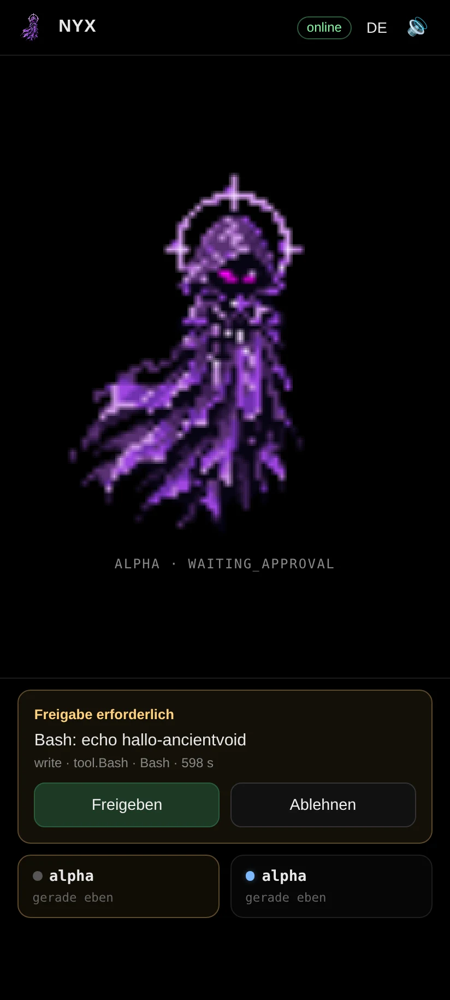
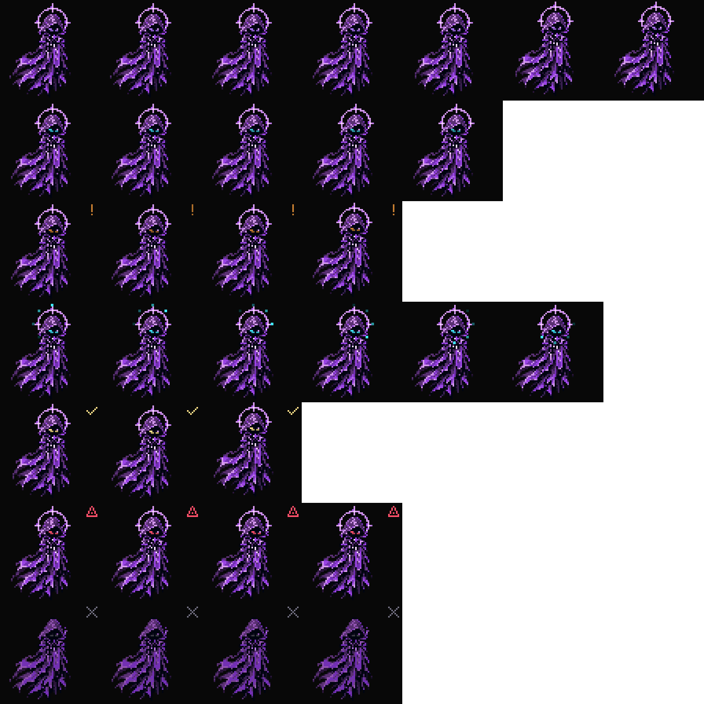

# VoidWarden

**The physical face of [AncientVoid](https://github.com/SiLenTTz/AncientVoid).**
VoidWarden is the pixel-art desk companion **Nyx**: she shows the aggregated
state of all your coding-agent sessions and takes `write` approvals by touch
— human-in-the-loop, literally on your desk. Local and self-hosted, no cloud
required — the hub is the source of truth, VoidWarden is a client.

| Phone / tablet kiosk (recommended) | Approve by holding |
|---|---|
|  |  |

The ESP32 board renders the same Nyx canon — all seven states
(idle, listening, approval pending, executing, success, error, offline)
come straight from the firmware renderer:



```
AncientVoid-Hub ──HTTP──▶ Companion (Node) ──WS──▶ Web-Kiosk (phone/tablet)
                   ▲                         │
                   │                         └─NDJSON/USB-Serial─▶ ESP32 (Nyx)
  Agents (claude, codex, opencode, …)        └── POST /api/approvals/:id/decide ◀─ touch
```

## What you get

- **State at a distance** — one pixel character, seven states, colors and
  motion carry the meaning; session tiles show what each agent is doing.
- **Approvals by touch** — pending `write` approvals take over the screen;
  hold (or tap) to approve, tap to decline. The companion only ever decides
  with its own least-privilege `display:` token — never `destructive`, never
  `reasonRequired`.
- **A voice** — optional local text-to-speech (Kokoro) with ghostly
  post-processing reads state changes and approvals. Fully off by default.
- **Fail loud** — hub down, link down or unknown frames show up visibly;
  nothing fails silently.
- **No cloud** — hub, companion and displays all live on your machine or
  tailnet.

## Displays

**Recommended: an old phone or tablet.** The web kiosk is the full
experience — touch approvals *and* voice — and needs no extra hardware.

**Optional: an ESP32 board** (Waveshare ESP32-2432S028R “CYD” class,
ILI9341 320×240) as a pure status display next to it. The firmware renders
Nyx over USB-serial; touch approval on the board is work in progress
(see roadmap).

## Status (Nov 15, 2026, honest)

**Built and running** — companion with serial bridge and simulator; board
renderer showing all seven states on real hardware; the **web kiosk** in
daily use: state stage with Nyx, session tiles, approval band with hold
gesture, speech bubbles, ticker, read-aloud and voice.

**Acceptance pending** — board photo review by the owner; board-side touch
(approval E2E on the device).

**Planned** — offline/dim/reconnect hardening on the board (P4), the full
pixel-art atlas (P5), on-device UI shell, agent overview, bubbles and voice
(P6–P9), multi-display support (P12), stage v2 with answerable questions
(P13). The roadmap is tracked as epics in the (German) engineering docs.

## Quick start

VoidWarden needs a running AncientVoid hub. Cascade:

```bash
# 1. in the AncientVoid repo: hub + first provider + VoidWarden tokens
./setup.sh --voidwarden          # prints agent: and display: tokens (once!)

# 2. here (sibling checkout, see note):
./setup.sh                       # hub check → contracts → install → config →
                                 # web kiosk → companion → prints the kiosk URL
```

The wizard is idempotent (re-running is safe) and fails loudly with an exit
code and a cascade hint when the hub is missing. Works fine without a board —
that is the normal phone/tablet path. Flags: `--yes`, `--hub-url=<u>`,
`--av-checkout=<path>`, `--web-port=<n>`, `--no-web-build`, `--check-board`.
Troubleshooting: [`docs/operations.md`](docs/operations.md) §4.

**Note for visitors:** `@ancientvoid/contracts` is a `file:` dependency on the
[AncientVoid](https://github.com/SiLenTTz/AncientVoid) repo. Its public
repository is being prepared — until its code lands there, VoidWarden cannot
be installed or built from this repo alone. The code is here to read and
watch; the hub follows shortly.

**Connect a phone/tablet:** open the kiosk URL (same network or tailnet; for
LAN set `web.host: "0.0.0.0"` + `web.optInAllInterfaces: true` — a deliberate
step), add it to the home screen. Touch approvals need the `display:` token;
voice is wired to `voice.*` in the config (off by default). The idle ticker
can be switched off with `web.idleTickerEnabled: false`.

**Board (optional):** flash the firmware and calibrate touch —
[`docs/operations.md`](docs/operations.md) §2; run it as a service:
[`tools/service/install.sh`](tools/service/install.sh).

### Configuration

`voidwarden.config.json` (git-ignored; see `voidwarden.config.example.json`)
holds everything: hub URL and token files, serial, poll/heartbeat intervals,
web kiosk, voice, UI. The important bits:

```jsonc
{
  "hub":  { "url": "http://127.0.0.1:7373", "tokenFile": "…", "decideTokenFile": "…" },
  "web":  { "enabled": true, "port": 8791, "idleTickerEnabled": true },
  "voice": { "enabled": false, "url": "http://127.0.0.1:8797/tts" },
  "ui":   { "approveGesture": "hold", "chatter": { "enabled": true } }
}
```

Tokens are always files with mode 600 — never in the JSON, never in logs.

## Security model

- **Least privilege** — the display reads with an `agent:` token (read-only)
  and decides with its own `display:` actor. Never a human device token.
- **The device never approves the unapprovable** — `destructive` and
  `reasonRequired` requests are shown as “decide on the PC”, without buttons.
- **Prompt-injection boundary** — agent text is display data. There is no
  path from agent output to an action, no auto-approve, no auto-decline.
- **No inbound ports, no shell with inputs** — the companion polls the hub;
  the kiosk connects out to the companion.

## Documentation

| File | Content |
|---|---|
| [`docs/spec.md`](docs/spec.md) | Binding spec: protocol v1, state machine, touch UX, quality bars W1–W9, security |
| [`docs/architecture.md`](docs/architecture.md) | Components, technology rules, AncientVoid integration, failure model |
| [`docs/testing.md`](docs/testing.md) | Test pyramid, gate, simulator, security invariants |
| [`docs/observability.md`](docs/observability.md) | Logging, monitoring, thresholds, diagnostics |
| [`docs/operations.md`](docs/operations.md) | Flashing, companion, systemd service, diagnosis |
| [`docs/adr/`](docs/adr/) | Architecture decisions (ADR-0001 … 0012) |
| [`CONTRIBUTING.md`](CONTRIBUTING.md) | Contribution and git rules |

Code, schemas and logs are English. Most engineering docs (`docs/`) are
German for now — translations welcome.

## AncientVoid?

[AncientVoid](https://github.com/SiLenTTz/AncientVoid) is the agent hub this
project displays: it runs your coding agents (claude, codex, opencode, …),
aggregates their sessions and exposes approvals over HTTP. VoidWarden reads
it with the HTTP API and the shared `@ancientvoid/contracts` package — no
other coupling.

## License

[PolyForm Noncommercial 1.0.0](LICENSE) — use, study, fork and contribute
for personal and non-commercial purposes. Commercial licensing: open an
issue.

> Required Notice: Copyright 2026 Jan Pfrommer
> (https://github.com/SiLenTTz/VoidWarden)

Pixel art, code and docs © 2026 Jan Pfrommer ([SiLenTTz](https://github.com/SiLenTTz)).
